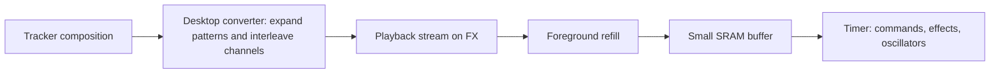

# FX song storage: research and proposed direction

Research date: 2026-10-16. Tracking: `ATMlib2FX-9zf`; footprint priority
clarification: `ATMlib2FX-dts`.

Decision update, 2026-10-17: `ATMlib2FX-hlh.2` **rejects the current 64-byte
compiled-stream implementation for production adoption**. Its music state
costs 20 B more SRAM; paired-shell flash estimates show no demonstrated engine
saving, with different graphics controls limiting attribution. See the
[architecture decision](fx-architecture-decision.md) for verified retained
ELF identities, comparison limits, open contracts and follow-up gates.
`ATMlib2FX-hlh.5` will measure one compact direct-ring candidate;
`ATMlib2FX-hlh.6` must select or reject its results before production FX export.

## Recommendation

The owner's primary goal is minimum **SRAM and AVR program flash**, in the
spirit of the original tracker. Optimize both the playback engine and its
streaming overhead. FX asset size is a separate resource; a larger song on FX
can be worthwhile if it removes device code or RAM. Measure the tradeoff.

The next candidate to measure keeps **asset-time pattern expansion and channel
interleaving**, with a smaller directly consumed sequential stream on FX. The desktop
converter resolves calls, returns, repeats, and channel scheduling. Foreground
device code copies bytes into a bounded buffer; the timer consumer applies
commands and musical effects. Avoid a second runtime interpreter, speculative
synth state, and general timestamped event scheduling.

This supersedes the earlier leading proposal to traverse original scores ahead
on the device. That approach remains a comparison candidate if further compact
stream measurements fail. The first compiled stream now has baseline/prototype
results in [the measurement report](fx-footprint-results.md); there are no
measured production-format contracts yet.

The useful idea in `FXport` is foreground loading into SRAM. Its shared byte
cursor and sequential refill model need redesign to preserve independent
channels and musical behavior. Move pattern expansion into the converter so
sequential refilling becomes appropriate. Start the prototype from the current
code and reuse that idea; carrying over the WIP wholesale offers little advantage
because its command decoder still reads PROGMEM.

Preserve the four voices, effects, independent tempos, and music/SFX behavior.
Keep source compositions usable through conversion; identical exported binary
layout is not a design requirement. Do not trade musical timing for a smaller
implementation without an explicit decision. Optional features should incur
cost only when included; compare equivalent enabled features with the original.

## Evidence inspected

- Current library: `master`, `f16387358a28d43204434019236305c6c8cc5efb`.
- Existing attempt: locally available `origin/FXport`,
  `c691dea85eb70545b65b64d324112ba0cdd01c09` (`WIP FX port`). The branch
  comparison used local refs; no remote refresh was performed.
- [Score layout and commands](../../docs/library-reference.md), [synthesizer](../../src/atm_synth.c),
  [command interpreter](../../src/cmd_parse.c), [state](../../src/atm_synth.h),
  [timer/oscillator implementation](../../src/osc.c), and the song/SFX examples.
- Reference game, found at `/Users/connorfranc/code/creaturegather/CreatureGathererFX`:
  `CreatureGathererFX.ino`, `src/lib/FxRead.hpp`, `src/lib/Blit.cpp`,
  `src/engine/draw.h`, `src/save/FlashBackend.hpp`, `src/save/SaveController.cpp`,
  `src/lib/FxReadCounter.hpp`, `fxlayout.toml`, `AGENTS.md`, and `docs/dev-flow.md`.
- Installed ArduboyFX source under
  `~/Library/Arduino15/packages/arduboy-homemade/hardware/avr/1.4.0/libraries/ArduboyFX/`.
  **1.4.0 is the board package version**; its library properties say **1.0.11**.
  The game's workaround comments use the package version when naming ArduboyFX.
  Upstream [ArduboyFX source](https://github.com/MrBlinky/ArduboyFX/blob/main/src/ArduboyFX.cpp)
  and [API](https://github.com/MrBlinky/ArduboyFX/blob/main/src/ArduboyFX.h)
  are additional references; the installed implementation informed the local analysis.

The initial 2026-10-16 work was source research. The measurements and decision
linked above supersede its uncompiled estimates and tool-availability unknowns.
The remaining sections retain the reasoning and required musical/integration
behavior; descriptions of proposed layouts are not a production ABI.

## What the existing library requires

There are two different workloads:

| Work | Current location | Consequence for FX |
| --- | --- | --- |
| Mix oscillators at 16,000 samples/second | Timer 3 ISR, with Timer 4 PWM | Keep independent of SPI and foreground progress |
| Advance music and SFX ticks, apply effects, decode commands | Timer callback reached from that ISR | Storage reads must move out of this path |
| Follow score headers, pattern offsets, and entry patterns | `atm_synth.c:100` onward | Replace AVR flash pointers with explicit score locations |
| Fetch commands | `process_channel()`, `atm_synth.c:339` | Currently copies four bytes using `memcpy_P` |
| Calls/repeats/returns | `cmd_parse.c:56` and `:151` | Nonsequential access, with a separate three-level stack per channel |
| Song restart | `atm_synth.c:384` onward | Waits for all music channels to stop, then restarts selected patterns |
| SFX overlay | Separate callback and `atm_sfx_state` | Independent tempo; background music keeps advancing behind the borrowed voice |

Each channel consumes a different number of bytes per tick. A tick can contain
several commands before reaching a delay. Consequently, neither a shared read
index nor a fixed bytes-per-frame assumption describes playback correctly.

The ISR explicitly enables nested interrupts before calling the playroutine
(`osc.c:288`). A foreground SPI transfer can therefore be interrupted by score
processing. FX reads inside that callback could disturb an existing FX read,
an OLED transfer, or a save command. A lock alone cannot make missing song data
available on time. Keeping SPI in foreground code avoids that ownership conflict.

## Review of `FXport`

The branch adds four 12-byte buffers, FX `init()`/`update()` methods, and buffer
helpers. It also correctly leaves the 128-byte note table in internal flash.

The architectural gaps matter more than the unfinished mechanics:

- One `readIndex` covers four independently consuming channels. It also cannot
  represent the independent SFX player.
- Refilling the next sequential FX bytes does not resolve a pattern call,
  return, repeat, or synchronized song loop in the original format. Those
  operations can instead be resolved during conversion while retaining the
  musical result and spending additional FX storage.
- Buffer capacity has no relationship yet to command density or the longest
  interval between foreground services.
- `update()` disables interrupts around all seeks and copies. That blocks the
  sample interrupt too; long enough refills would disturb audio timing.

Concrete WIP problems reinforce that this is a sketch, not a usable backend:

- All four channel pointers in `setup()` refer to `channelBuffers[0]`.
- `init()` assumes a table of four 24-bit channel addresses, unlike the existing
  score header, pattern offsets, and entry-pattern indices. No matching exporter
  is present in the branch changes.
- The loaded channel addresses are not assigned to `channelPointer[]`, and
  `songLength` is unused. Refilling does not publish a new `writeIndex`.
- Buffer helpers are not connected to playback: `process_channel()` still
  calls `memcpy_P`, and header/pattern lookup still uses `pgm_read_*`.
- `nextReadIndex()` tests `>` instead of `>=`, allowing index 12 in a 12-byte
  buffer. Reader advancement and underrun handling are unfinished.

Fixing those local problems would still leave the control-flow and timing
questions above. Foreground buffering is worth keeping; this particular buffer
contract is the part to replace.

## Approaches compared

| Approach | Benefit | Cost or limitation | Assessment |
| --- | --- | --- | --- |
| Read FX directly from the timer callback | Small conceptual change | Collides with graphics, display, and saves; requires invasive bus coordination | Reject for this integration |
| Load the whole song into SRAM | Simple access after loading | Song size competes directly with the game's limited RAM | Useful only for deliberately tiny assets |
| Run the entire sequencer in foreground | Potentially small device state and code | Notes/effects become late during rendering or other blocking work; replaying missed ticks cannot restore missed audio | Comparison only if timing requirements can be met |
| Keep interpreter in ISR with small raw-byte caches | Preserves much existing code | A call or return can miss the cache immediately; a miss must defer work safely | Cache alone is insufficient |
| Resolve patterns ahead on device and queue timed commands | Retains compact scores and timer-paced playback; isolates SPI | Runtime traversal, scheduling, publication, and lookahead state add SRAM/program flash | Comparison candidate |
| Compile patterns and channel order into a playback stream during asset generation | Removes runtime traversal and permits one sequential music buffer | Larger FX assets, new converter, small stream decoder, explicit loop handling | Leading footprint candidate, subject to measurement |

## Proposed boundary

The converter owns pattern stacks, repeat expansion, channel ordering, and
logical tick scheduling. It can emit compact tick gaps and channel command
groups instead of general timestamps or oscillator snapshots. Keep existing
note/effect operands where that minimizes decoder changes; choose framing from
measured device code cost. The foreground refiller owns only the next FX stream
location, remaining extent/loop information, and buffer publication state.

A single interleaved music stream permits one refill cursor and one buffer
without assuming that the four channels consume equal numbers of bytes. Channel
timing has already been resolved into the stream. This is different from the
shared index over four independent raw pattern buffers in `FXport`.

The timer consumer owns live effect state, oscillator parameters, active/mute
state, and the playback clock. Preserve effects before commands for each
channel, channels 0 through 3, and the existing tempo update points. Tempo
changes take effect when consumed. The existing loop implementation can process
another pass immediately in the same tick; the converter must represent that
ordering explicitly, including any extra effect pass.

Represent an intro and repeatable stream segment with explicit extents when the
composition permits it; the foreground refiller can continue across that boundary
without an ISR seek or flushing unread bytes. The converter must account for
global all-channels-stopped synchronization and loop-pattern changes. Do not
assume every score is a simple per-channel loop: conversion must establish a
repeatable traversal state or report an unsupported/oversized result. Preserve
live effect state across boundaries as the original does.

Use distinct music and SFX timelines. Preserve background music advancement
while its channel is borrowed, SFX replacement, and restoration of the live
music oscillator state when SFX ends. Pause, stop, and track replacement must
take effect independently of how much future work has been prepared.

The stream framing and buffer size are outputs of the prototype, not fixed
here. Use encoded delays or equivalent compact framing to distinguish valid
quiet playback from an underrun, without maintaining a second future clock or
duplicating live channel state. Publish complete due groups; never expose half
a command or advance only some channels of a music tick. Have the converter
report the largest due group and reject content that cannot fit the chosen
buffer contract. Prefer fixed storage and direct calls over dynamic allocation
or a general storage/scheduler interface.

FX copies run with audio interrupts enabled. Use single-producer/single-consumer
ownership and short publication operations with correct compiler ordering; any
critical section must be bounded to publication, not the SPI transfer. An
underrun should freeze advancement of that player before partial application,
retain its last oscillator values, and expose a diagnostic count. The desired
result under supported game workloads is zero underruns.

## Asset and API direction

Use the existing score encoding as converter input and as the behavioral
reference. The FX output may be a simpler stream:

- An FX asset address is a 24-bit **offset within the game's FX data section**.
  `FX::seekData()` adds the page base established by `FX::begin()`. Do not add
  that base twice or cast an FX location to an AVR pointer.
- Eliminate runtime pattern positions/return stacks in the compiled candidate.
  Use compact stream extents where practical; widen before adding the FX base.
  If retaining original-pattern traversal as a comparison, use 16-bit
  score-relative positions rather than full FX addresses in each stack entry.
- Pattern offsets are little endian in the AVR score structs. Two-byte long
  delay operands are explicitly high-byte-first in the command macros/parser.
  The converter must decode these fields separately. FX's typed 16-bit reads
  are big endian. Specify the output byte order to minimize device decoding.
- Read bounded raw bytes. The existing unconditional four-byte command copy
  can pass the end of a short asset; the output converter can supply deliberate
  padding/framing so the smallest device decoder has a valid read contract.
- Validate content on the host: format/channel limits, offsets, command sizes,
  nesting rules, tempo validity, terminating delays/stops, and maximum command
  bursts. Serialize explicitly; dumping a host C struct can introduce different
  padding from AVR structs.

A possible public surface is `playFX(dataOffset)` using generated stream
metadata, or a descriptor if that is smaller overall, plus a foreground
`service()` call. Keep a C-callable boundary for the C core; place ArduboyFX C++
calls in a small bridge. Exact types and whether PROGMEM and FX backends coexist
should follow resource measurements. Choose the backend at build time where
that saves bytes; a shipping FX build should not automatically include legacy
score traversal. Tiny PROGMEM SFX may avoid a second streaming buffer; compare
that option with FX SFX instead of requiring both paths. Keep unused features
out of the measured shipping configuration.

The reference game's `fxlayout.toml` already supports raw binary assets.
Append song assets through its generator and `make gen`; preserve declaration
order and the single `dist/fxdata.bin` image. Its existing
`FxRead::indexed24()` reconstructs three bytes because of an observed typed-read
problem. Prefer generated direct addresses for an initial song; if a song
address table is added, use the same proven raw-byte approach.

## Timing, RAM, and game integration

CreatureGathererFX renders at 52 fps, approximately 19.23 ms per frame. A song
can request 8–255 ticks/second, independently of SFX. The current divider
actually produces `2000 / floor(2000 / requested_rate)` ticks/second: a request
of 255 gives approximately 285.7, or a 3.5 ms interval. A normal frame can span
about six such ticks before allowing for stalls. Preserve this existing timing
in the port first; changing tempo accuracy would require a separate decision.

Size lookahead from the **maximum encoded work within the longest service
gap**, using actual effective tick rates and both players, plus the largest
atomic due batch and a margin. Twelve bytes per channel has no demonstrated
sufficiency. Delay records should avoid allocating an oscillator snapshot for
every future tick. Buffer bytes and metadata count against any state saved by
the new stream format.

Call `service()` in the outer loop before the `nextFrame()` early return, with
additional opportunities between long game phases as needed. All calls must
occur after the previous FX/OLED transaction has ended. Serving once per frame
is acceptable only if measured lookahead covers the longest complete frame.

Three game-specific constraints must be addressed:

1. **SRAM and nested stack.** The game's dated 2026-10-10 checkpoint reports
   1,747 bytes static SRAM and 509 bytes painted stack headroom, with a roughly
   150-byte effective reserve. Its static ceiling is 2,160 bytes. These figures
   are not a current budget measurement. Include synth state, selected buffers,
   refill metadata, and nested audio interrupt stack use in a fresh measurement.
   The library README's old code-size numbers are not current integration costs.
   As an uncompiled source estimate with 16-bit AVR pointers, byte alignment,
   and all effects enabled, the current core globals total about 182 bytes
   (including 140 bytes for four channel states); one SFX state adds about
   44 bytes. Pattern stacks plus stack indices account for approximately
   52 bytes across the music channels, and 13 bytes in the SFX channel.
   Removing them is a potential gross saving, before replacement stream state
   and buffers. These are source estimates, not measured net savings or evidence
   of remaining usable RAM.
2. **Save ownership.** Save code programs/erases this same chip and waits or
   polls for busy completion. Do not assume ordinary song reads remain available
   during those operations. Initially pause/mute FX music and FX SFX before a
   save begins, skip refills throughout the save, and resume after final busy
   completion. Seamless music during saves would need a separately measured
   buffering or chip-specific suspend design.
3. **Read accounting.** `FxReadCounter` budgets ordinary metadata reads and
   excludes existing raster/save streaming. Give audio streaming an explicit
   category and its own measurements, preserving metadata assertions. Do not
   route continuous refills through the metadata counter unchanged or silently
   weaken it. Keep the game's render-to-display interval free of added reads.

## Proposed implementation sequence and decision points

First establish the original core's measured program flash, static SRAM, and
stack with a defined feature configuration and representative songs/SFX. Report
song bytes separately from engine bytes. Keep the existing note table and effect
implementation initially; optimize them only if whole-image measurements justify
the change.

Prototype conversion of one four-channel song with nested calls/repeats into a
sequential interleaved stream. Measure a direct foreground refiller and minimal
timer consumer with one music buffer. Record the removed traversal state/code,
added framing/refill state/code, total FX asset expansion, static SRAM, painted
stack headroom, service gaps, and underruns. Include FX drawing/display. Compare
against PROGMEM playback with the same musical features and against a minimal
original-format approach if the compiled design does not clearly improve costs.

Prefer a design with no net SRAM increase and the smallest measured engine
program flash. Do not claim either outcome before building; if SRAM and program
flash trade off, report both instead of inventing a combined score or accepting
overhead merely because the game still fits. Include required note tables,
buffer metadata, and SFX state; report both marginal cost when ArduboyFX is
already linked and total standalone cost. Absolute game fit remains a separate
acceptance constraint.

Once footprint evidence selects a candidate, pin stream framing, loop encoding,
and ownership; then cover global loops, tempo changes, pause/stop, and SFX
overlay. Finish export/packing, content checks, game service placement, read
accounting, and save pause/resume. Keep measured changes separately attributable
in Beads. A general runtime lookahead scheduler is not the default fallback.

Future verification should compare tick-level oscillator/effect traces against
PROGMEM playback for independent channel delays, three-level calls, repeats,
loop restart, maximum tempo, long delays, all enabled effects, and music/SFX
interaction. Exercise FX addresses above `0x010000`, assets near the size limit,
buffer wrap, dense command batches, underrun/recovery, display concurrency, and
save busy periods. Check actual timer interrupts and stack in Ardens/device
runs; host-only tests cannot establish SPI or interrupt correctness.

The remaining design decisions are stream framing/capacity, permitted service
gap, FX expansion limits, SFX storage choice, and whether music must continue
during saves. The prototype should establish the smallest measured device
implementation; the initial integration assumes save-time pause and preserves
the current musical behavior.
